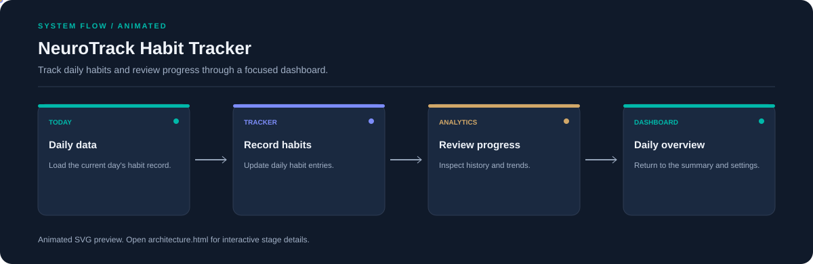

# NeuroTrack Habit Tracker

**Track daily habits and review progress through a focused dashboard.**

[](https://github.com/chyk2468/Habit-Tracker-AI)

## 1. Project Title & Tagline

Track daily habits and review progress through a focused dashboard.

## 2. Problem Statement

Habit progress is hard to understand when daily activity is not recorded consistently. NeuroTrack groups daily logging, progress analytics, and settings in one interface.

## 3. Project Preview

Add a screenshot or short GIF of the live interface with a representative input and result.

[Open interactive architecture](architecture.html)

## 4. Overview

The app takes user input, runs the configured processing pipeline, and presents the result in the interface. The workflow below shows the major stages.

## 5. Key Features

- Dashboard overview of daily activity.
- Daily habit tracking.
- Analytics view for reviewing progress.
- Navigation between dashboard, tracker, analytics, and settings.

## 6. Architecture / Workflow



Open the [interactive architecture explorer](architecture.html) to select a stage and inspect its role.

## 7. Tech Stack

React, Vite, JavaScript, Tailwind CSS, Framer Motion

## 8. Installation & Setup

```bash
git clone https://github.com/chyk2468/Habit-Tracker-AI.git
cd Habit-Tracker-AI/neurotrack-app
npm install
npm run dev
```

## 9. Usage

Open the local Vite URL, record habit activity, and navigate to analytics to review progress. Check the current data hook to understand how records are persisted.

## 10. Project Structure

- `neurotrack-app/src/App.jsx`: app shell and view selection
- `neurotrack-app/src/hooks/useNeuroData.js`: daily data logic
- `neurotrack-app/src/pages/`: dashboard, tracker, analytics, and settings
- `neurotrack-app/src/components/`: shared interface components

## 11. Results & Demo

Add a screenshot of the dashboard and tracker, plus a short GIF demonstrating one habit update and the analytics view.

## 12. Future Enhancements

- Add export and backup for habit history.
- Improve accessibility and mobile navigation.
- Add reminders and configurable goals.
- Add tests for daily rollover and progress calculations.

## 13. License

Check the repository and frontend dependency licences before reuse.
