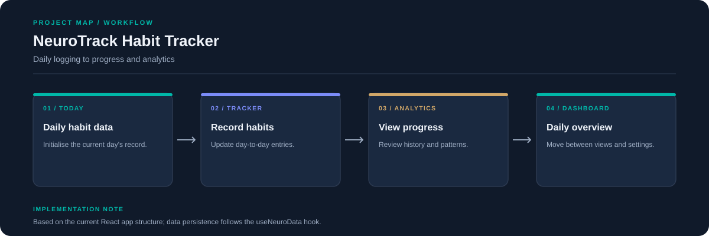

# NeuroTrack Habit Tracker

A React and Vite application for tracking daily habits and reviewing progress through dashboard and analytics views.



## Run locally

```bash
npm install
npm run dev
```

Open the local URL printed by Vite.

## Main source areas

- `src/App.jsx`: app shell and current view
- `src/hooks/useNeuroData.js`: daily data state
- `src/pages/`: dashboard, tracker, analytics, and settings
- `src/components/layout/`: navigation
- `src/`: interface and styling

This README describes the application structure visible in the current source. See the root README for the repository overview.